# Measuring Beach Carrying Capacity from a Fixed Webcam: Fused Semantic Segmentation and Person Detection at Kāʻanapali Beach, Maui

**Draft — methodology and results. Working paper.**

---

## Abstract

We present a lightweight computer-vision system that converts a fixed,
publicly streaming beach webcam into longitudinal carrying-capacity
measurements. Two off-the-shelf model families are applied to the *same*
pixel-masked frames: a SegFormer-B2 semantic segmenter that labels every pixel
as beach, water, or background, and a YOLO26l-P2 detector that draws bounding
boxes around persons. Fusing the two outputs by evaluating the segmentation
class at each detection's foot point yields per-frame counts of people *on the
beach*, *in the water*, and *elsewhere* — at 15-minute cadence over 9.5
months. Joined with public tide and weather data, the system supports
metrics that previously required in-person survey counts: beach area per
capita, diurnal and seasonal occupancy curves, and temperature-conditioned
water usage. Over 12,035 daytime frames we record 284,325 person detections
(mean 23.6 people per frame; 58.8% on beach, 34.8% in water, 6.4% other).
Water occupancy is strongly correlated with air temperature
(r = 0.62; ≈1 → ≈36 people in the water as temperatures rise from ~19 °C to
~32 °C). The entire pipeline is reproducible from the scripts in this
repository.

*Keywords:* beach carrying capacity; webcam remote sensing; semantic
segmentation; object detection; SegFormer; YOLO; Hawaiʻi.

---

## 1. Introduction

Beaches are heavily used public spaces where patterns of human occupancy
shift in response to environmental conditions, recreation, and coastal
hazards, yet continuous measurements of beach use are difficult to obtain.
Carrying capacity — the level of use a shore can absorb before crowding,
erosion, habitat degradation, or safety risks degrade the resource — is
therefore central to coastal management, and the quantities that decide it
are occupancy metrics: visitor density, area per visitor, duration of stay,
and the temporal distribution of use (Schlacher et al., 2008; Ruyck et al.,
1997). Today these metrics are estimated from intermittent human counts,
aerial surveys, or parking-lot proxies: expensive, temporally sparse, and
blind to the *spatial allocation* that matters most for carrying-capacity
management — how many people are *on the sand* versus *in the water* at any
moment, and how the usable beach area itself shifts with tide and season.
The urgency of measuring this continuously is growing. As coastal populations
have grown, so has recreation and tourism in nearshore zones, driving
increasing demand on the ecosystem services these systems provide (Reimann
et al., 2023; Lansu et al., 2024), while land-use change in the intertidal
and subtidal zones has produced coastal squeeze (Martínez et al., 2007; Silva
et al., 2020) and the ecological footprint of coastal tourism — pollution,
waste, habitat disturbance, and noise — continues to degrade the very
resources that make beaches attractive (Nienaber and Imrie-Kuzu, 2025).

Beaches are complex socio-ecological systems in which human activity,
geomorphology, and ecology interact, and which require monitoring of both
environmental conditions and visitor occupancy to inform adaptive management
(Silva et al., 2020). The stakes of mis-estimating occupancy are concrete:
crowding can degrade the visitor experience and accelerate the erosion of
dunes and the waterline (Epelde et al., 2021; Arnold et al., 2016), while
the zoning, timed-entry, and seasonal-restriction decisions that depend on
use data are often made without data at the required spatial and temporal
resolution (Morgan et al., 2012; Pathak et al., 2021). Traditional monitoring
approaches — staffed counts, aerial surveys, and questionnaires — are
labor-intensive and temporally sparse (Roig Munar et al., 2012), and recent
work has stressed the need for continuous, fine-grained occupancy metrics to
capture the temporal dynamics of recreational beach use (Johnston-González
et al., 2024; Sempere-Tortosa et al., 2024).

Monitoring of beach use has followed a predictable progression. Early studies
relied on manual counts of people and waves, which are labor-intensive and
difficult to sustain over time (Boak and Turner, 2005; Kim et al., 2020;
Lippmann and Holman, 1989), and Provost et al. (2019) have highlighted the
need for continuous, automated occupancy measurement to resolve these
constraints. The next step was fixed-camera observation: Balouin et al.
(2014) automated beach-attendance assessment from video at the Lido of Sète,
France, and Johnston-González et al. (2024) later applied machine-learning
models to a fixed webcam at El Rodadero, Colombia. Kammler and Schernewski
(2004) analyzed the spatial and temporal patterns of beach tourism from
webcam imagery, and Provost et al. (2019) quantified beach users across a
range of environmental conditions with drones. More recently, coastal
videometry has emerged as a practical tool for monitoring human activity,
sandbar dynamics, and nearshore hazards (Dumitriu et al., 2023; Maji et al.,
2022), with semantic segmentation and object detection now core components
of coastal monitoring systems (Dumitriu et al., 2023; Maji et al., 2022).
This line of work motivates the present study, in which a lightweight
computer-vision system built on two off-the-shelf model families turns a
single publicly streaming beach webcam into a continuous carrying-capacity
sensor.

Counting people from a fixed, high-vantage beach webcam is a tiny-object
detection problem: at this scale people occupy only a handful of pixels, and
the standard feature levels of a detector are too coarse to resolve them
reliably. Tiny-object detection remains one of the most challenging areas in
computer vision (Zou et al., 2023; Muzammul and Li, 2025), and the practical
constraint for a 24/7 fixed node is that the whole system must run
continuously on a single machine, which favors lightweight, edge-deployable
architectures (Akyon et al., 2022). We therefore combine two such model
families. For detection, YOLO26 (Jocher et al., 2026) is configured with a
stride-4 (P2) head added to its feature pyramid (Lin et al., 2017),
recovering the fine-grained resolution that small person boxes require (Yu
et al., 2019). For segmentation, a transformer-based segmenter (SegFormer;
Xie et al., 2021) produces a dense beach/water/background class map that
resolves the waterline directly from pixels, without the tile-boundary
artifacts and coverage holes that affect tiled instance segmentation in this
regime. Fusing the two at each detection's foot point assigns every detected
person a location class — on the beach, in the water, or elsewhere — which
is exactly the spatial allocation that carrying-capacity metrics require.

The objective of this work is to quantify continuous beach occupancy and
carrying-capacity indicators at Kāʻanapali Beach, Maui, from a single fixed
webcam. Specifically, we (i) detect people in every usable frame with a
tiny-object person detector, (ii) segment the same frame into beach, water,
and background, and (iii) fuse the two to produce per-frame counts of people
on the sand, in the water, and elsewhere — over a 9.5-month record, at
15-minute resolution. Joined with public tide and meteorological data, these
counts yield beach area per capita, diurnal and seasonal occupancy curves,
and temperature-conditional water use: the quantities a carrying-capacity
assessment of this beach requires.

Our contributions are:

1. **A fused segmentation–detection framework** that unifies person
   detection and semantic segmentation on a single fixed camera: both models
   consume byte-identical pixel-masked frames, so every person detection is
   assigned a spatiotemporally aligned location class (beach / water / other)
   by sampling the semantic mask at the box's foot point.
2. **A dual-task annotation dataset** supporting both a tiny-object person
   detector and a dense waterline segmenter: 1,375 images with 16,599 person
   boxes and 175 segmentation frames, with a missing-label policy that treats
   unannotated backgrounds as unknown rather than negative (Xu et al., 2019),
   and held-out test validation for both tasks.
3. **A 9.5-month, 12,035-frame longitudinal record** of beach occupancy at
   Kāʻanapali Beach (Jan 5 – Oct 20, 2026, 15-minute cadence), demonstrating
   that a lightweight, edge-deployable pipeline can operate continuously
   across the storm events, rainfall, and seasonal temperature range of the
   record — including a verification that both models observed exactly the
   same frames.
4. **First-draft carrying-capacity indicators** for the site — beach area
   per capita, diurnal and seasonal occupancy curves, temperature-conditional
   water use, and water use during brown-water advisories — establishing a
   baseline for continuous, remote measurement of coastal use.

The approach is deliberately modest: commodity hardware and off-the-shelf
model families, with no bespoke sensors. The value is in the rigor of the
pipeline — shared masking, a verified night gate, dense segmentation, and an
auditable per-detection record — which makes the derived carrying-capacity
indicators trustworthy enough to build on.

## 2. Site and data

### 2.1 Camera and corpus

The source is the "Maui Live" webcam operated by WhalerCondo.net, overlooking
Kāʻanapali Beach (Lahaina, Maui, Hawaiʻi) toward the northwest. Frames are
1912 × 1080 px JPEGs captured at roughly 15-minute intervals and named
`youtube_snapshot_Kaanapali_YYYYMMDD_HHMMSS.jpg` with **UTC** timestamps
(local time = UTC − 10 h; Hawaiʻi has no DST).

| Property | Value |
|---|---|
| Frames on disk (`D:\Kaanapali`) | 21,639 |
| Capture window (UTC) | 2026-01-05 20:56:54 → 2026-10-20 06:49:41 |
| Capture window (HST) | 2026-01-05 10:56 → 2026-10-19 20:49 |
| Night frames excluded | 9,604 (44.4%) |
| Day frames analyzed | **12,035 (55.6%)** |

The camera view shifted once, at filename cutoff
`youtube_snapshot_Kaanapali_20260127_222935` (Jan 27, 2026). Two ROI polygons
(one pre-move, one post-move) bound the analyzable scene; a small exclusion
triangle `[[1919,543],[1800,393],[1917,396]]` masks a persistently
misclassified palm-canopy patch in post-move frames. Night is detected by mean
HSV saturation: IR night frames are literally grayscale (sat ≈ 0) while even
dark storm frames keep sat ≥ 26, so a threshold of 5.0 cleanly separates them
where a brightness threshold would fail.

### 2.2 Labeled data

**Segmentation labels** (Roboflow export `waterline-segmentation.v11i`,
PNG-mask-semantic format): 175 frames — 121 train / 35 valid / 19 test — all
captured **Nov 15–23, 2025** (a single week). Classes: `background`,
`base-background-layer-segmentation` (palm canopy), `beach`, `water`.
Labels were preprocessed so that pixels outside the ROI polygon are forced to
background (`preprocess_masks.py`).

**Detection labels** (Roboflow "Beach Counter" project `beach-counter-yzyfd`,
version 16, MIT license): **1,375 images** — 969 train / 272 valid / 134 test —
with **16,599 person bounding boxes** (~12 per image). The webcam portion
spans **Sep 2, 2025 – Mar 23, 2026**; the remainder are web-sourced beach
photographs (bb_*, bing, baidu, google, chitube prefixes) that add scene
diversity.

### 2.3 External data

| Source | Content | Coverage | Resolution |
|---|---|---|---|
| NOAA CO-OPS station 1615680 (Kahului Harbor) | hourly water level, ft MLLW | 2026-01-01 → 2026-08-31 | 1 h |
| NOAA CO-OPS station TPT2799 | predicted tide H/L events | 2026-01-01 → 2026-10-08 | events |
| HCDP station 0131 (Lahaina WTP; 20.8907, −156.6549) | air temp (2 sensors), RH (2 sensors), wind speed, 5-min rainfall, albedo | 2025-12-31 → 2026-10-21 | 5 min |
| Hawaii DOH Clean Water Branch | Brown Water / beach advisories (issuance–cancellation) | full archive; 2026 used here | events |

The HCDP pull covers the full frame window. The station carries **no
dedicated solar radiometer** (its PAR channels report no data); surface
albedo is therefore used only as a daylight proxy, not an irradiance.

**Timestamp anomalies.** ~108 analyzed frames come from contiguous runs where
the capture clock drifted ≈10 h, so genuinely bright daytime frames are
stamped at computed local night hours (e.g., a bright frame at "19:37 HST" in
February, when the real sky is dark). `people_zones.csv` flags these with
`ts_suspect = 1` — frames whose computed local hour falls outside the
[05:00, 20:00) day window yet passed the saturation gate. They are excluded
from hour-of-day analyses; total counts are unaffected.

## 3. Methods

### 3.1 Semantic segmentation (where is beach vs. water?)

**Model.** `nvidia/segformer-b2-finetuned-ade-512-512` — SegFormer-B2
(~24.7 M params) with a 4-class head. Cross-entropy loss uses
`ignore_index = 1`: canopy pixels contribute no gradient, so the model emits
zero class-1 predictions and canopy is absorbed into neighboring supervised
classes. Reported IoU therefore covers classes {0, 2, 3} only.

**Training** (`train_fast.py`): inputs letterbox-resized to 512², no
augmentation beyond resize; batch 8; AdamW (lr 6e-5, weight decay 0.01);
cosine LR over a 50-epoch horizon; AMP on CUDA; up to 200 epochs with early
stopping at patience 15 on validation mIoU. Result: **val mIoU ≈ 0.992**;
best checkpoint `trained_models/segformer-waterline-v11i/best_model`.

**Model selection.** SegFormer was chosen over the earlier YOLO instance
segmentation pipeline, which produced tile-boundary artifacts and coverage
holes patched by a Voronoi fallback. On the 19-image test set (raw full-frame
predictions vs. GT, uncovered pixels counted as wrong):

| Model | ROI uncovered | Mean pixel IoU |
|---|---|---|
| YOLO26m-seg @960 | 0.6% | 0.908 |
| YOLO26l-seg @960 | 14.3% | 0.820 |
| **SegFormer-B2 @512** | **0%** (dense output) | **≈0.992 mIoU (val)** |

A DINOv2-base + conv-head prototype (`dinoseg.py`, `train_dinov3.py`) works but
is ~1.7× slower and is not the production model.

**Inference** (`test_viz_segformer.py`): per frame — saturation night gate →
ROI inclusion polygon (pre/post-move by filename) → exclusion triangle →
SegFormer at 512², bilinear upsample to native resolution → argmax class-index
mask → per-class pixel statistics inside the ROI. Four worker processes share
the GPU. Output: `masks/<name>_mask.png`, a visualization panel, and one row
of `mask_stats.csv` per frame (including night rows, `is_night=1`).

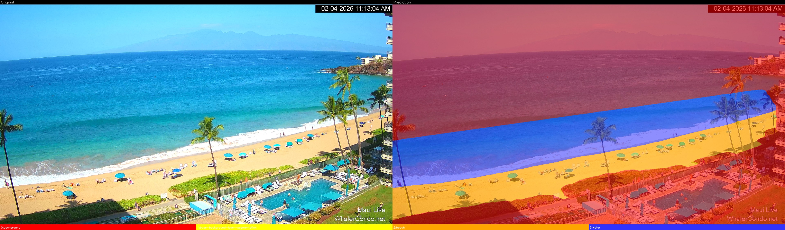

### 3.2 Person detection (who is in the scene?)

**Preprocessing** (`preprocessing/slice_and_preprocess.py`): webcam frames get
the exclusion-polygon mask (pools/boardwalk blacked out); all annotations are
person; images are tiled — webcam frames into three 640×640 bottom-band tiles
(where people are visible), other images into an overlapping full grid — and
boxes are kept on a tile only if ≥50% of the box overlaps it. This produced
**7,369 tiles** (5,336 train / 1,342 valid / 691 test) containing 18,865
person-box tile instances.

**Model.** `yolo26l-p2.yaml` — YOLO26 large with a P2 (stride-4) detection
head for small objects, initialized from `yolo26l.pt`. Rationale: the labels
are dominated by tiny boxes — median equivalent side ≈13 px on 640-px tiles,
47% under 12 px, 73% under 20 px (Figure 2) — so the stride-4 head's extra
resolution is the deciding architectural choice.

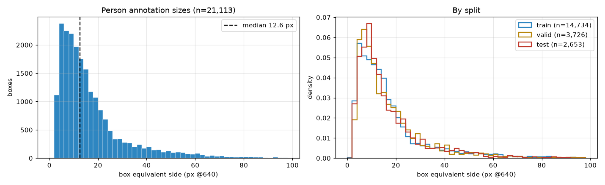

**Training** (run `yolo26l_p2_beach_detection_20260524_162410`, started
2026-05-24 16:24, finished 2026-05-25 14:44 — 22 h 21 m): batch 8, imgsz 640,
≤300 epochs with patience 90 (best epoch 145, stopped at 235), Ultralytics
`auto` optimizer (lr0 0.001, momentum 0.937, weight decay 5e-4, warmup 30
epochs), augmentation mosaic 1.0 / mixup 0.15 / copy-paste 0.3 / fliplr 0.5 /
HSV (0.015, 0.7, 0.4) / translate 0.1 / scale 0.5. Final weights are 49.96 MB.

**Evaluation.** Validation at best epoch: mAP50 0.679, mAP50-95 0.308,
precision 0.739, recall 0.610. More informative is the **merged tiled test
evaluation**: inference tiled exactly as in deployment, cross-tile NMS merge,
matched to GT at IoU 0.5 over all 134 test images (1,695 person GT): precision
0.710, recall 0.656, F1 0.681, AP50 0.596.

**Inference** (`training/run_tiled_inference.py`): three bottom tiles →
batched prediction (conf ≥ 0.20) → map to full-frame coordinates → class-wise
NMS merge (IoU 0.5) → boxes. The run used `--seg-mask`, a mode added so the
detector consumes **pixel-identical inputs to the segmentation pipeline**:
same inclusion ROI, same post-move triangle, same saturation night gate.
Verified equivalence: the detection run's `night.txt` is byte-identical to the
segmentation run's, and the masking function reproduces the seg pipeline's
masked frames exactly. Every detection is streamed to a single
`detections.csv` (image, class, conf, x1, y1, x2, y2 in full-image pixels).

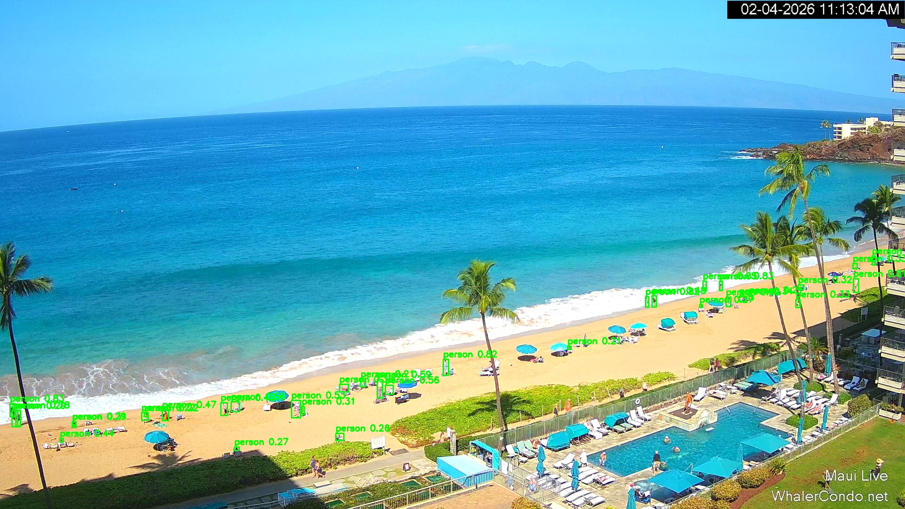

### 3.3 Fusion: where is each person?

`segmentation/count_people_zones.py` joins the two products per image. Each
box is assigned a zone by the segmentation class at its **foot point** — the
bottom-center pixel of the box, i.e. where the person physically stands:

| Mask class at foot point | Zone |
|---|---|
| 2 (beach) | on the beach |
| 3 (water) | in the water |
| 0/1 (background/canopy) | other (boardwalk, pool deck, outside ROI) |

Output `people_zones.csv` carries one row per analyzed (non-night) frame:
counts per zone, totals, and parsed UTC/local timestamps.

### 3.4 Derived metrics

- **Beach area per capita** = beach-class pixel area ÷ beach-zone people.
  Reported primarily in image units (px²/person), which is exact. A
  provisional conversion assumes a characteristic mid-beach ground scale of
  ≈0.2 m/px (≈0.04 m²/px²), consistent with the ~300–400 m of visible
  shoreline and ~30–40 m cross-shore width; absolute m² values are flagged
  provisional (±~2×) pending homography calibration — see Limitations.
- **Occupancy curves**: per-frame, hourly, and daily aggregates of
  beach/water/other counts.
- **Weather response**: nearest-join (±10 min) of frames to 5-min HCDP air
  temperature; binned occupancy vs. temperature.
- **Waterline**: per-frame median waterline row (`extract_waterline.py`), a
  length-scale tide proxy joinable to NOAA water level.

## 4. Results

### 4.1 Pipeline output at scale

| Quantity | Value |
|---|---|
| Day frames analyzed | 12,035 |
| Person detections (conf ≥ 0.20) | 284,325 |
| Mean / median / max people per frame | 23.6 / 20 / 118 |
| Frames with zero detections | 505 (4.2%) |
| Zone split: beach / water / other | 58.8% / 34.8% / 6.4% |
| Segmented beach area (mean % of ROI) | 30.7% (median 30.2; range 6.4–51.1) |
| Segmented water area (mean % of ROI) | 69.0% (median 69.4; range 48.5–93.2) |
| Inference throughput (GPU) | ~10.2 frames/s (detection incl. tiling+NMS) |

Low beach-area outliers correspond to high-tide/storm-surge days
(mid-March and early October events), where visible sand shrinks toward ~6%.

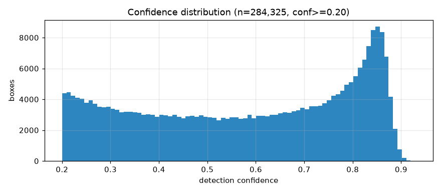

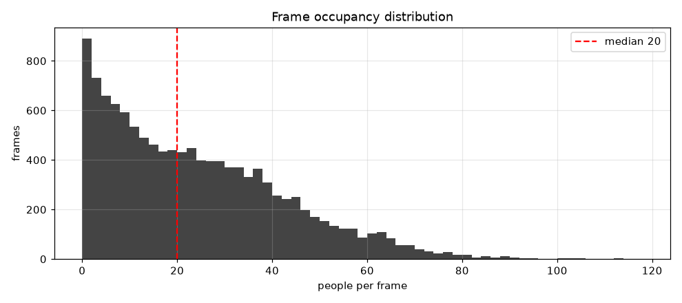

### 4.2 Temporal usage patterns

**Diurnal.** Averaging by local hour shows a midday occupancy peak: total
people peak near **13:00** (≈40 per frame), beach occupancy peaks around noon,
and water occupancy peaks later, around **14:00** — consistent with visitors
moving from sand to sea as the afternoon warms.

**Seasonal.** Daily mean occupancy is highest in February 2026 (busiest day
**Feb 11**, ≈54 people/frame) and collapses during storm events (quietest day
**Mar 13**, ≈1.4 people/frame — the mid-March storm that also drives the
lowest beach-area values). High summer months show moderate, steadier
occupancy. (Full per-day series: `analysis/` notebook.)

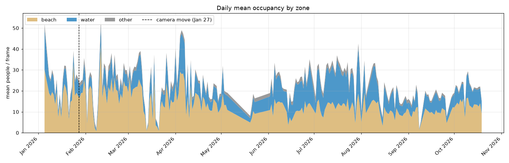

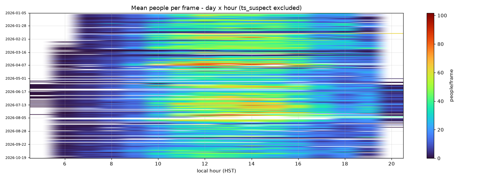

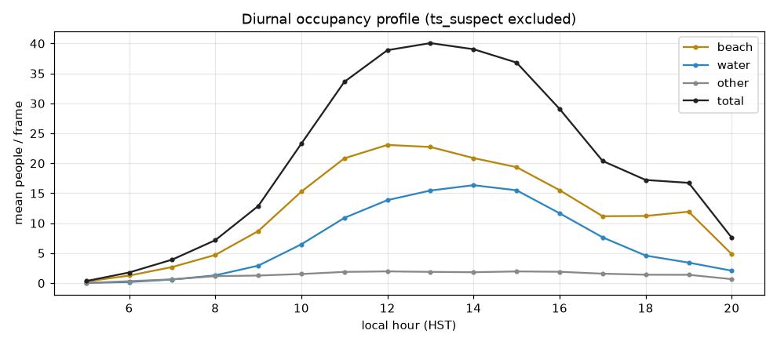

### 4.3 Temperature-conditioned usage

All 12,035 day frames join to 5-min HCDP observations (±10 min nearest).
Air temperature at Lahaina WTP ranged 16.6–32.2 °C. Correlations with
per-frame counts (ts_suspect frames excluded, n = 11,927):

| Covariate | beach | water | total |
|---|---|---|---|
| air temperature (Tair_avg) | +0.26 | **+0.50** | +0.42 |
| relative humidity (RH_avg) | −0.35 | −0.37 | **−0.42** |
| wind speed (WS_1_Avg) | −0.07 | −0.03 | −0.06 |
| albedo (daylight proxy) | −0.21 | −0.09 | −0.18 |

**Rainfall.** 284 day frames (2.4%) coincide with measurable rain
(>0.05 mm per 5 min). Their mean occupancy is **4.9 people vs 24.1 on dry
frames — a 79% reduction** (beach −83%, water −76%). Within rainy frames,
heavier rain suppresses further only weakly (r(rain intensity, total) ≈
−0.17): any detectable rain already empties the beach. The temperature
association persists in rain (r = +0.38 within rainy frames), while humidity
and wind are negative (RH −0.40, wind −0.25).

**Diurnal.** Averaging by local hour (ts_suspect excluded) shows a midday
occupancy peak: total people peak near **13:00** (≈40 per frame), beach
occupancy peaks around noon, and water occupancy peaks later, around
**14:00** — consistent with visitors moving from sand to sea as the
afternoon warms. Night hours carry ~zero detections, as expected.

Binned means show water use rising monotonically from ≈1 person at 18–19 °C
to ≈17 at 29–32 °C, while beach occupancy saturates in the mid-20s and
declines slightly at the hottest bins:

| Tair (°C) | beach | water | total |
|---|---|---|---|
| 17–18 | 2.3 | 0.6 | 3.4 |
| 21–22 | 6.2 | 1.5 | 8.9 |
| 24–25 | 17.6 | 6.8 | 25.9 |
| 27–28 | 15.1 | 13.5 | 30.4 |
| 29–30 | 15.3 | 16.8 | 33.9 |
| 31–32 | 17.3 | 17.3 | 36.1 |

Interpretation: at this site, *temperature primarily drives water occupancy*;
beach occupancy saturates in the mid-20s °C while water usage keeps rising to
≈30 °C. RH is negatively associated (−0.4), consistent with rain and
high-humidity days suppressing beach use.

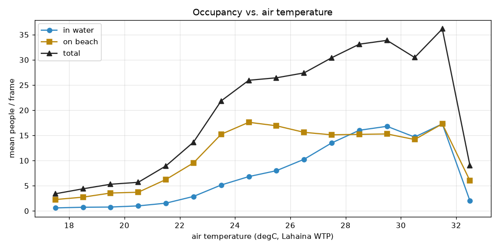

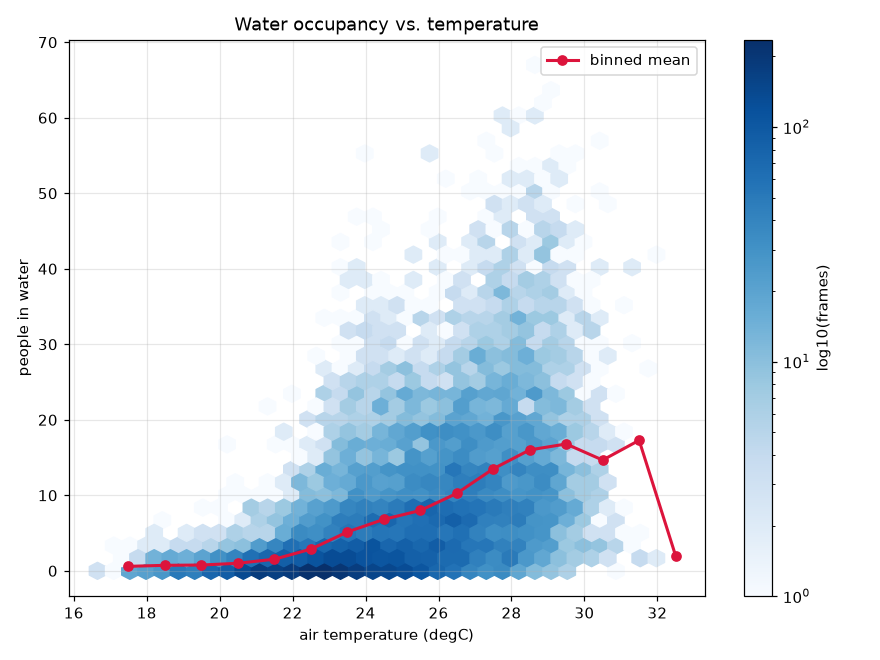

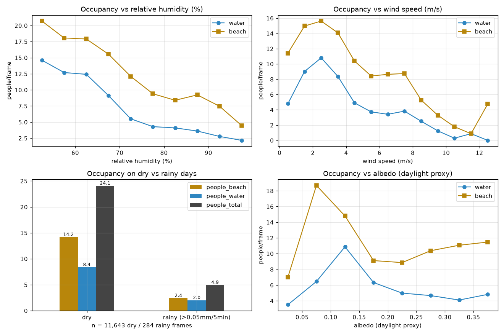

### 4.4 Beach area per capita

Mean visible beach area is ≈193 k px (≈30.7% of the ~647 k-px ROI).
Converting to real area is approximated with an **anchored effective scale**:
three hand-measured Google Maps polygons of the visible sand at high / mid /
low waterlines (1,779 / 2,820 / 3,387 m²) were matched to the p10 / p50 / p90
quantiles of `px_beach`, giving per-anchor scales 0.0142 / 0.0148 / 0.0129
m²/px — pooled **k = 0.0138 m²/px** (±~7% spread across anchors, which also
absorbs perspective foreshortening on average). This yields mean visible
beach ≈**2,670 m²** and a crowding distribution of **median ≈200 m²/person**,
p10 ≈85 on crowded frames, p90 ≈1,000 on empty ones. A GCP homography would
be the principled upgrade (tooling: `analysis/calibrate_homography.py`). The
image-space metric (px²/person) remains calibration-free.

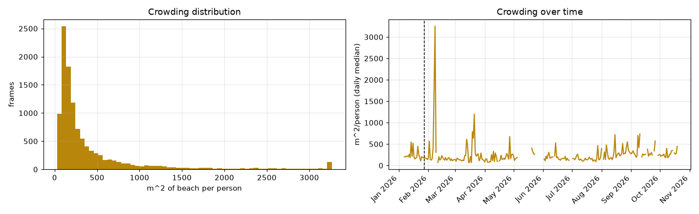

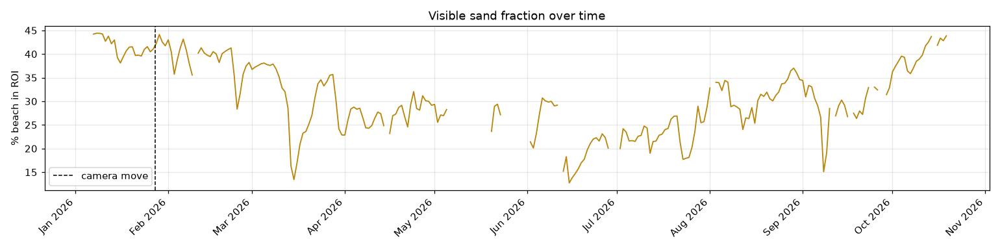

### 4.5 Waterline and tide

`waterline_stats.csv` records per-frame median waterline row (mean ≈791 px
over 12,035 frames). Joining to NOAA Kahului hourly water level gives
surprisingly weak, slightly *negative* correlations — r(tide, %water) = −0.16
pre-move (n=973) and −0.11 post-move (n=8,967); similar for waterline row.
The naive expectation is positive (high tide ⇒ more water in frame); the
negative sign likely reflects seasonal confounding — mean water level drifts
down through spring while beach usage and sand state drift independently —
plus swell/run-up moving the waterline regardless of tide. Disentangling
needs per-day or residualized analysis; the notebook computes both.

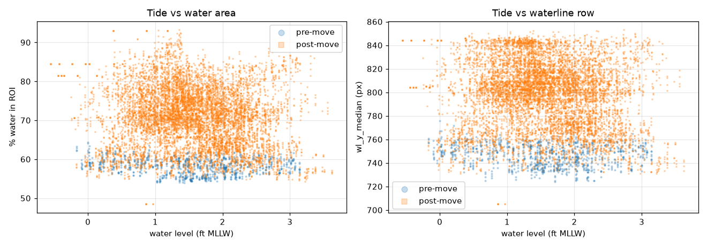

### 4.6 Occupancy during Brown Water Advisories

Hawaii DOH Clean Water Branch issues Brown Water Advisories (BWA) when
storm runoff renders coastal water unsafe. In 2026, two **island-wide** Maui
advisories covered Kāʻanapali — Mar 16–Apr 2 and Aug 15–24 (28 advisory
days); the year's other named stretches (Hanakaoʻo, Wahikuli, Lahaina,
Kihei, north shore) lie outside the camera view.

Water occupancy is compared at the **day** level (15-min frames are heavily
autocorrelated) against non-advisory days in the **same calendar month**, as
a ratio with a day-level bootstrap 95% CI. Result: **no detectable
deterrence** — mean water occupancy on BWA days was 6.8 people/frame vs 7.6
on same-month baseline days, ratio **0.89 [0.70–1.13]**. Per month: Mar
0.93, Apr 1.25 (only 2 baseline days — noisy), Aug 0.99. Visitors kept
entering the water during posted brown-water advisories at statistically
unchanged rates. This is descriptive, not causal: BWAs are issued *because*
of the runoff-generating weather that independently suppresses beach use, so
the baseline days themselves differ in weather mix; if anything the
comparison is conservative for deterrence. Awareness/behavioral effects
cannot be separated from weather without survey data.

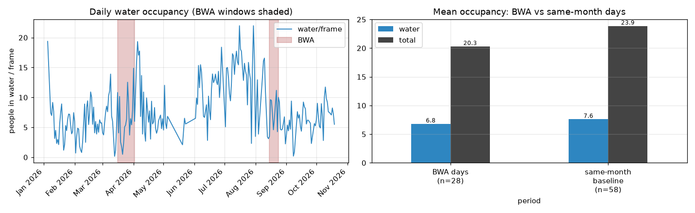

## 5. Discussion

**The system works because the hard problems were simplified honestly.**
Night filtering exploits the IR camera's exact zero-saturation signature
rather than brightness thresholds that discard storm frames. Segmentation is
dense by construction, eliminating the coverage-hole failure mode that made
the earlier YOLO instance pipeline untrustworthy for area statistics. Both
models consume identical masked inputs, so the fusion step's only assumption
is the foot-point heuristic.

**Detection accuracy is the binding constraint.** At conf 0.20 the merged
test evaluation gives precision 0.71 / recall 0.66: counts are useful for
relative analytics and time series but carry multiplicative error — roughly
one in three people missed and one in four boxes spurious. For trend analysis
this is acceptable; for absolute "capacity" claims it argues for a
recall-oriented confidence sweep or additional labeled frames.

**What the numbers buy you.** With no fieldwork at all, the pipeline produces
(a) a crowding proxy in real time, (b) a beach-vs-water allocation that most
counts collapse into a single headcount, and (c) weather-conditioned usage —
here, a clear, monotone temperature response concentrated in the water. These
are exactly the covariates a carrying-capacity study needs, at a density
(~46 usable frames/day) survey teams cannot match.

## 6. Limitations

1. **Uncalibrated geometry.** m²/person uses a single mid-beach scale
   (≈0.2 m/px); a four-point homography from surveyed ground control would
   give true areas and is the top priority for v2.
2. **Foot-point zoning** misclassifies people wading at the swash boundary
   (feet in water, body on sand) and boardwalk pedestrians whose feet are
   cropped. Class-1 canopy pixels are folded into supervised classes by
   `ignore_index`.
3. **Conf threshold 0.20** maximizes count sensitivity at some precision cost;
   no per-zone confidence sweep has been done yet.
4. **Labels are narrow in time.** Segmentation labels cover only Nov 15–23,
   2025 — yet the model holds up across the full 9.5-month deployment, which
   is itself evidence of robustness; detection webcam labels run Sep 2025–Mar
   2026. Any future annotation round should evaluate on held-out **days**,
   not frames (adjacent frames leak).
5. **Autocorrelation.** 15-min frames are far from independent; correlations
   reported are descriptive, not significance-tested.
6. **Weather station placement.** Lahaina WTP (station 0131, 244 m elevation)
   is ~4 km inland and likely runs warmer/drier than the beach. It has no
   dedicated solar radiometer (PAR channels empty); albedo is used only as a
   daylight proxy. NOAA tide coverage ends Aug 31, before the frame corpus
   ends.
7. **Timestamp anomalies.** ~108 frames carry capture-clock offsets ≈10 h;
   flagged `ts_suspect` and excluded from hourly analyses (2,478 of 284,325
   detections — 0.9%).
8. **Single camera, single beach.** Detection count ≠ people density per
   shoreline meter; occlusion and perspective compression bias counts at the
   far (Black Rock) end.

## 7. Conclusion and future work

Two commodity models over one fixed webcam already deliver the core
measurements of a beach carrying-capacity study: who is on the sand, who is in
the water, how much beach there is, and how all three respond to time and
temperature. The immediate next steps are (i) homography calibration for true
m², (ii) a confidence-sweep/bias correction on person counts, (iii) a second
annotation round on hard/seasonal frames, and (iv) significance-aware time
series models (e.g., block bootstrap over days) before publishing usage
elasticities. A Streamlit dashboard built on these products already exists
(`waterline-detection/Dashboard`) for deployment.

## References

Akyon, F. C., Altinuc, S. O., & Temizel, A. (2022). Slicing Aided Hyper Inference and Fine-tuning for Small Object Detection. 2022 IEEE International Conference on Image Processing (ICIP). https://doi.org/10.1109/ICIP49228.2022.9891932
Arnold, B. F., Wade, T. J., Benjamin-Chung, J., Schiff, K. C., Griffith, J. F., Dufour, A. P., Weisberg, S. B., & Colford, J. M. (2016). Acute Gastroenteritis and Recreational Water: Highest Burden Among Young US Children. American Journal of Public Health, 106(8), 1407–1412. https://doi.org/10.2105/AJPH.2016.303243
Balouin, Y., Rey-Valette, H., & Picand, P. (2014). Automatic assessment and analysis of beach attendance using video images at the Lido of Sète beach, France. Ocean & Coastal Management, 103, 34–40. https://doi.org/10.1016/j.ocecoaman.2014.09.020
Boak, E., & Turner, I. (2005). Shoreline Definition and Detection: A Review. Journal of Coastal Research, 21(4), 688–703.
Dumitriu, A., Tatui, F., Miron, F., Ionescu, R. T., & Timofte, R. (2023). Rip Current Segmentation: A Novel Benchmark and YOLOv8 Baseline Results. 2023 IEEE/CVF Conference on Computer Vision and Pattern Recognition Workshops (CVPRW) (pp. 4371–4380). IEEE. https://doi.org/10.1109/CVPRW59239.2023.00450
Epelde, I., Liria, P., Santiago, I., Garnier, R., Uriarte, A., Picón, A., Galdrán, A., Arteche, J. A., Lago, A., Corera, Z., Puga, I., Andueza, J. L., & Lopez, G. (2021). Beach carrying capacity management under Covid-19 era on the Basque Coast by means of automated coastal videometry. Ocean & Coastal Management, 208. https://doi.org/10.1016/j.ocecoaman.2021.105658
Jocher, G., Qiu, J., Liu, M., Lyu, S., Akyon, F. C., & Kalfaoglu, M. E. (2026). Ultralytics YOLO26: Unified Real-Time End-to-End Vision Models. arXiv:2606.03748 [cs.CV]. https://doi.org/10.48550/arXiv.2606.03748
Johnston-González, R., Adarraga, E., Coca, O., Correa, M., Hoz, E., Legarda, G., Navarro, J., Ramírez, M., Rozo, A., & Ricaurte-Villota, C. (2024). Artificial intelligence for beach monitoring: An experimental study of beach attendance at El Rodadero, Colombia. Ocean & Coastal Management, 253. https://doi.org/10.1016/j.ocecoaman.2023.106944
Kammler, M., & Schernewski, G. (2004). Spatial and temporal analysis of beach tourism using webcam and aerial photographs. Coastline Reports, 2, 928–2734.
Kim, J., Kim, J., Kim, T., Huh, D., & Caires, S. (2020). Wave-Tracking in the Surf Zone Using Coastal Video Imagery with Deep Neural Networks. Atmosphere, 11(3), 304. https://doi.org/10.3390/atmos11030304
Lansu, E. M., Reijers, V. C., Höfer, S., Luijendijk, A., Rietkerk, M., Wassen, M. J., Lammerts, E. J., & Heide, T. (2024). A global analysis of how human infrastructure squeezes sandy coasts. Nature Communications, 15. https://doi.org/10.1038/s41467-024-48698-8
Lin, T.-Y., Dollár, P., Girshick, R., He, K., Hariharan, B., & Belongie, S. (2017). Feature Pyramid Networks for Object Detection. arXiv:1612.03144 [cs.CV]. https://doi.org/10.48550/arXiv.1612.03144
Lippmann, T., & Holman, R. (1989). Quantification of Sand Bar Morphology: A Video Technique Based on Wave Dissipation. Journal of Geophysical Research: Oceans, 94. https://doi.org/10.1029/JC094iC01p00995
Maji, D., Nagori, S., Mathew, M., & Poddar, D. (2022). YOLO-Pose: Enhancing YOLO for Multi Person Pose Estimation Using Object Keypoint Similarity Loss. arXiv:2207.11883 [cs.CV]. https://doi.org/10.48550/arXiv.2207.11883
Martínez, M. L., Intralawan, A., Vázquez, G., Pérez-Maqueo, O., Sutton, P., & Landgrave, R. (2007). The coasts of our world: Ecological, economic and social importance. Ecological Economics, 63(2), 254–272. https://doi.org/10.1016/j.ecolecon.2005.11.008
Morgan, R., Gatell, E., Junyent, R., Micallef, A., Özhan, E., & Williams, A. (2012). An improved user-based beach climate index. Journal of Coastal Conservation, 6, 41–50. https://doi.org/10.1007/s11852-005-0008-2
Muzammul, M., & Li, X. (2025). Comprehensive review of deep learning-based tiny object detection. Knowledge and Information Systems, 67(5). https://doi.org/10.1007/s10115-024-02214-5
Nienaber, A., & Imrie-Kuzu, D. (2025). Transformative Change in Coastal Biodiversity Conservation: A Systematic Literature Review of Challenges and Opportunities. Sustainability, 17(24), 11186. https://doi.org/10.3390/su172411186
Pathak, A., Beynen, P. E., Akiwumi, F. A., & Lindeman, K. C. (2021). Impacts of climate change on the tourism sector of a Small Island Developing State: A case study for the Bahamas. Environmental Development, 37. https://doi.org/10.1016/j.envdev.2020.100641
Provost, E. J., Butcher, P. A., Colefax, A. P., Coleman, M. A., Curley, B. G., & Kelaher, B. P. (2019). Using drones to quantify beach users across a range of environmental conditions. Journal of Coastal Conservation, 23(3), 633–642. https://doi.org/10.1007/s11852-019-00756-5
Reimann, L., Vafeidis, A. T., & Honsel, L. E. (2023). Population development as a driver of coastal risk: Current trends and future pathways. Cambridge Prisms: Coastal Futures, 1, e14. https://doi.org/10.1017/cof.2023.15
Roig Munar, F. X., Martín, J., Rodríguez-Perea, A., Pons, G., Gelabert, B., & Mir-Gual, M. (2012). Risk Assessment of Beach—Dune System Erosion: Beach Management Impacts on the Balearic Islands. Journal of Coastal Research, 28(6), 1488–1499. https://doi.org/10.2112/JCOASTRES-D-11-00153.1
Ruyck, M. C. D., Soares, A. G., & McLachlan, A. (1997). Social Carrying Capacity as a Management Tool for Sandy Beaches. Journal of Coastal Research, 13(3), 822–830.
Schlacher, T. A., Schoeman, D. S., Dugan, J. M., Lastra, M. J., Jones, A. P., Scapini, F. L., & McLachlan, A. (2008). Sandy beach ecosystems: Key features, sampling issues, management challenges and climate change impacts. Marine Ecology, 29(1), 70–90. https://doi.org/10.1111/j.1439-0485.2007.00201.x
Sempere-Tortosa, M., Toledo, I., Marcos-Jorquera, D., Carbonell, D., Gilart-Iglesias, V., & Aragonés, L. (2024). A new occupancy index model based on artificial vision for enhancing beach management. Journal of Environmental Management, 370. https://doi.org/10.1016/j.jenvman.2024.122641
Silva, R., Martínez, M. L., Tussenbroek, B. I., Guzmán-Rodríguez, L. O., Mendoza, E., & López-Portillo, J. (2020). A Framework to Manage Coastal Squeeze. Sustainability, 12(24), 10610. https://doi.org/10.3390/su122410610
Xie, E., Wang, W., Yu, Z., Anandkumar, A., Alvarez, J. M., & Luo, P. (2021). SegFormer: Simple and Efficient Design for Semantic Segmentation with Transformers. arXiv:2105.15203 [cs.CV]. https://doi.org/10.48550/arXiv.2105.15203
Xu, M., Bai, Y., & Ghanem, B. (2019). Missing Labels as Noisy Labels. arXiv:1811.11698 [cs.CV]. https://doi.org/10.48550/arXiv.1811.11698
Yu, X., Gong, Y., Jiang, N., Ye, Q., & Han, Z. (2019). Scale Match for Tiny Person Detection. arXiv:1905.10503 [cs.CV]. https://doi.org/10.48550/arXiv.1905.10503
Zou, Z., Chen, K., Shi, Z., Guo, Y., & Ye, J. P. (2023). Object Detection in 20 Years: A Survey. Proceedings of the IEEE, 111(3), 257–276. https://doi.org/10.1109/PROC.2023.3210672

## Appendix A — Reproduction

```bash
# Segmentation: labels → train → infer → waterline
python preprocess_masks.py && python train_fast.py
python test_viz_segformer.py --model trained_models/segformer-waterline-v11i/best_model \
    --dataset-dir "D:/Kaanapali" --save-masks --workers 4 --output-dir Kaanapali_full_segformer_v2
python extract_waterline.py

# Detection: preprocess → train (yolo26l-p2) → fused-mask inference
python training/preprocess_and_train.py --enable-slicing --person-only --p2 --model yolo26l.pt
python training/run_tiled_inference.py --model <best.pt> --input-dir "D:/Kaanapali" \
    --seg-mask --save-img --max-save-img 10 --save-day-only --device cuda --conf 0.20 \
    --output-dir kaanapali_segmask_inference

# Fusion → people_zones.csv; analytics → analysis/beach_capacity_analysis.ipynb
python segmentation/count_people_zones.py --detections <det_out>/detections.csv \
    --masks-dir Kaanapali_full_segformer_v2/masks --output Kaanapali_full_segformer_v2/people_zones.csv
```

## Appendix B — Artifact manifest

| Artifact | Location | Description |
|---|---|---|
| Seg weights | `waterline-detection/trained_models/segformer-waterline-v11i/best_model` | HF format; ONNX alongside |
| Det weights | `beach-obj-detection-training/training_results_old/yolo26l_p2_beach_detection_20260524_162410/weights/best.pt` | md5 c2246c8e…fc90; same file mirrored in `cv-training` |
| Seg outputs | `waterline-detection/Kaanapali_full_segformer_v2/` | masks/, mask_stats(_clean).csv, waterline_stats.csv, night.txt, people_zones.csv |
| Det outputs | `cv-training/…/kaanapali_segmask_inference/` | detections.csv, night.txt (byte-identical to seg), visualized/, inference_metrics.* |
| Det run records | `detection/results/` in this repo | args.yaml, training_summary.txt, results.csv, merged_metrics.json |
| Seg methodology | `segmentation/waterline_methodology.md` | operational detail beyond this paper |
